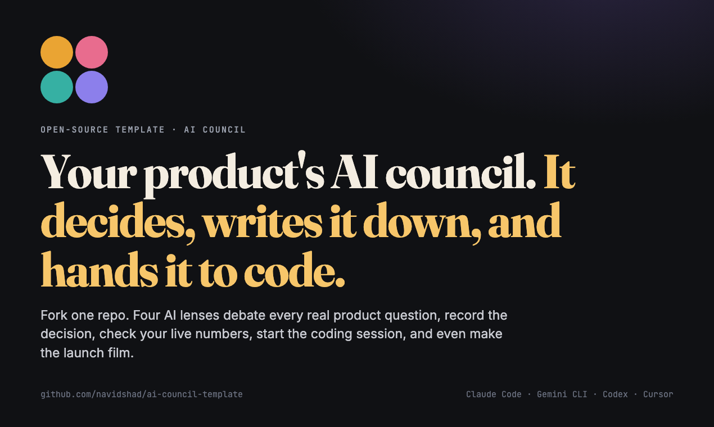
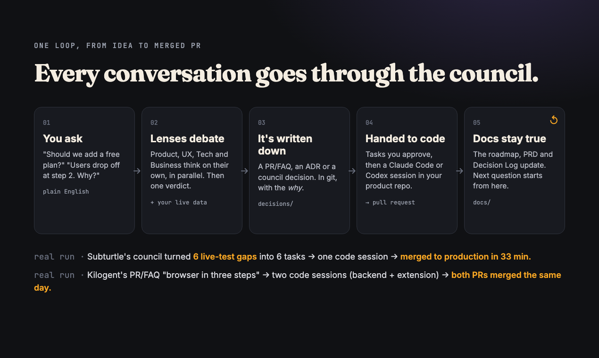
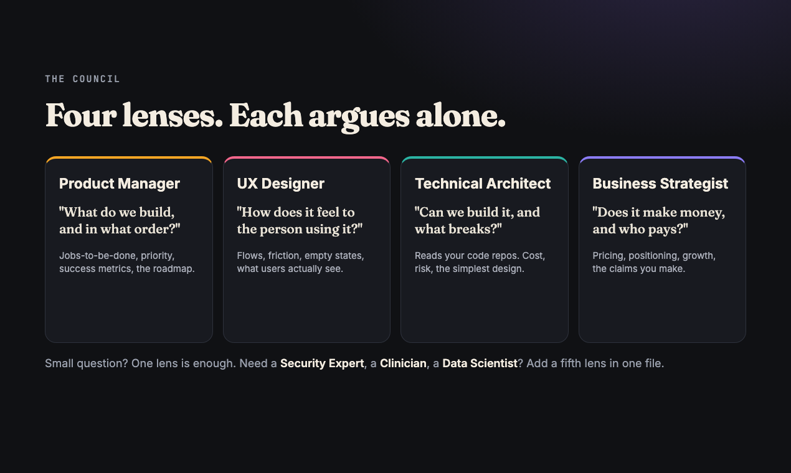
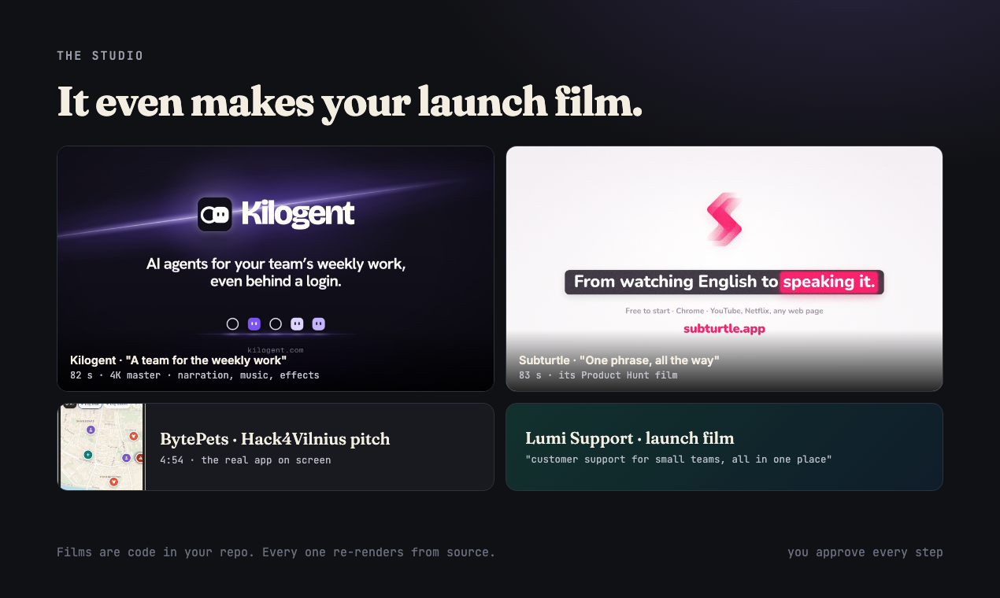
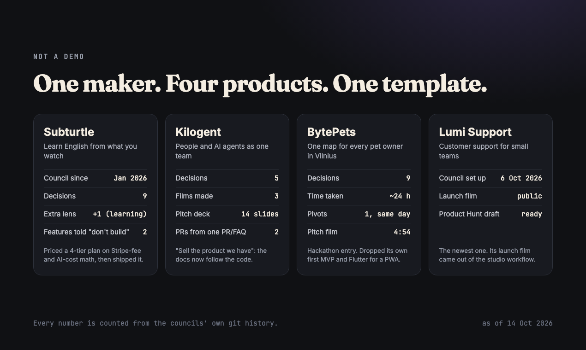

# AI Council

**An AI product team that lives in a git repo.** Four AI lenses (Product, UX, Tech, Business) debate every real product question, write the decision down, check your live numbers, hand the work to a coding session in your product repo, and even make your launch film.

It is a **template**, not a service. Click **Use this template**, tell your agent "set up the council", and it interviews you and fills everything in. No server, no SaaS, no lock-in: plain markdown and the agent you already use.

## Why

If you build alone or in a small team, you play every role: PM, designer, architect, marketer. The hard part is not the code any more. It is making good calls, fast, and remembering *why* you made them.

The council gives you a second (and third, and fourth) opinion on every real decision, keeps the reasoning in git, and turns the decision into work, all through one conversation.

## One loop, from idea to merged PR

1. **You ask** in plain English. "Should we add a free plan?" "Users drop off at step 2. Why?"
2. **The lenses debate.** Each one thinks alone, in parallel, grounded in your docs, your code and (with connectors) your live data. The main agent writes one verdict.
3. **It is written down** as a PR/FAQ, an ADR or a council decision, with a line in the Decision Log.
4. **It is handed to code.** You approve the tasks, and the council starts a Claude Code or Codex session in your product repo with a brief. That session opens the PR. A person merges.
5. **The docs stay true.** The roadmap and PRD update, and a `Ship` line links the decision to the PR.

Real runs, from the products this template came out of:

- **Subturtle**'s council turned 6 gaps from a live test into 6 tasks, then one code session. The fix was merged to production 33 minutes later.
- **Kilogent**'s PR/FAQ "browser in three steps" started two code sessions (backend and browser extension). Both PRs merged the same day.

## Quick start

1. Click **Use this template** (or fork / clone), and open the new repo in Claude Code, Codex, Gemini CLI or Cursor.
2. **Run setup.** Ask your agent to "set up the council" (or just start a council request — it will offer). It interviews you, fills in your product facts and the `docs/` skeleton, and commits. See `SETUP.md`.
3. Open `AGENTS.md` and try a request: ask the council a small strategic question, or draft a PR/FAQ from `templates/pr-faq-template.md`.
4. Optional: connect your analytics, payments and tracker to your agent, and list your code repos during setup.
5. Every decision gets a permanent file in `decisions/` and one line in the Decision Log in `docs/README.md`.

## Works with

The same workflow files drive more than one agent tool, so the council runs the same way whichever you use:

- **Claude Code** — the personas spawn as parallel `Task` subagents from `agents/*.md`. See `CLAUDE.md`.
- **Codex** — reads `AGENTS.md` natively; run each lens as its own isolated task. See `AGENTS.md` → "How to spawn personas".
- **Gemini CLI** — the personas are native subagents in `.gemini/agents/*.md` (call them, or force one with `@product-manager`). See `GEMINI.md`.
- **Antigravity** and **Cursor** — read `AGENTS.md` + the persona files directly; spawn each lens as its own agent. See `GEMINI.md`.

`AGENTS.md` is the shared source of truth for every tool. The per-tool files (`CLAUDE.md`, `GEMINI.md`) only add *how to spawn agents* in that tool — they add no new rules. If you change a persona, update both `agents/<role>.md` and its Gemini mirror `.gemini/agents/<role>.md` so all tools stay in sync.

## The council

The council is four AI agents. Each one looks at a question from one angle:

- **Product Manager** — what to build, and in what order
- **UX Designer** — how the product looks and feels to use
- **Technical Architect** — how to build it, and if it is possible
- **Business Strategist** — money, pricing, and how to grow

When you ask the council something, each agent gives its own view on its own. Then the main agent joins the views into one clear decision and updates the docs. (Need a fifth, domain-specific lens — a Security Expert, a Clinician, a Data Scientist? See "Add a domain lens" in `AGENTS.md`.)

## How a request flows

A request goes through up to three steps. Small things stop early. Only real decisions go all the way.

1. **Sort it** — Is this small (a typo, a quick fact, moving a file)? Then just do it. Is it a real decision? Then go on.
2. **Think** — How much thinking does it need? Often one expert is enough. The full council is only for big choices that touch many teams.
3. **Write it down** — Which kind of doc do we make?

The three kinds of docs:

- **PR/FAQ** — "Should we build this feature?" → saved in `decisions/pr-faq/`
- **ADR** — "Which technical option do we pick?" → saved in `decisions/adr/`
- **Council decision** — "What is the big choice that touches many teams?" → saved in `decisions/council/`

How much you think (step 2) and which doc you write (step 3) are two separate choices. They can also join up — a PR/FAQ can turn into a council decision if the choice gets big.

Every doc also adds one line to the Decision Log in `docs/README.md`.

## Live data and your code

- **Connectors.** If your agent has MCP connectors for analytics (Mixpanel, PostHog), payments (Stripe), your tracker (ClickUp, Linear) or your support inbox, the council queries them before it argues. Numbers go into the decision with a source and a date. Read-only by default. See `AGENTS.md` → "Connectors".
- **Code repos.** The Technical Architect reads your product code to check claims. The council never edits that code: it writes a brief and hands it to a separate coding session. See `AGENTS.md` → "Hand-off to a code session".

## Marketing pieces (the studio)

The council can also make your marketing films, launch images, video covers and slides. Ask for one, and an agent follows `STUDIO.md`. The studio has three layers: a shared **foundation** (your mark, colours, type and honesty rules), one or more **design kits** (each a complete look with reusable parts), and **design cases** (each piece, made with one kit). For a piece, the agent picks or builds a kit, agrees a brief with you, writes the story, shows you key frames, then builds the picture and the sound as code. The template ships no studio files; they are set up the first time you ask. Videos are never committed — each one re-renders from its source, and every published video is listed in `studio/videos.md`. Uploads stay private until you publish them.

## Built with it

This template was not designed on a whiteboard. It grew out of one maker running real products with it since January 2026, then was cleaned up and opened:

- **Subturtle** (learn English from what you watch). The first council. It priced a four-tier plan on Stripe-fee and AI-cost math, told two features "don't build yet", and added a fifth lens: a language-learning scientist.
- **Kilogent** (people and AI agents as one team). Its council decided to "sell the product we have" and made the docs follow the code. The studio made three films and a 14-slide pitch deck.
- **BytePets** (one map for every pet owner in Vilnius). A hackathon entry: nine decisions in about a day, including dropping its own first MVP. Pitch film: [watch](https://youtu.be/_fosbssDrBc).
- **Lumi Support** (customer support for small teams). Launch film: [watch](https://youtu.be/cZOMOee6HRA).

Using it for your product? Open an issue or a PR to add it here.

## Examples

- **"Fix a typo on the pricing page."**
  Small. Just fix it. No doc needed. (Stops at step 1.)

- **"Should we add a daily streak feature?"**
  A real choice about building a feature. Write a **PR/FAQ**. → `decisions/pr-faq/`

- **"Which database should we use?"**
  A technical choice with a few options. One expert (the Technical Architect) is enough. Write an **ADR**. → `decisions/adr/`

- **"Should we raise the price of the top plan?"**
  A big choice. It touches money, users, and marketing. Ask the full **council**. → `decisions/council/`

## What is in this repo

- `AGENTS.md` — the full rule book (read this first)
- `SETUP.md` — the one-time setup routine (Workflow 0): an agent fills the template in for your product
- `STUDIO.md` — how agents make marketing films, stills and slides (Workflow 4). The `studio/` folder is created the first time a piece is asked for
- `CLAUDE.md` — how to run the workflows in Claude Code (Codex reads `AGENTS.md` directly)
- `GEMINI.md` — how to run them in Gemini CLI and Antigravity
- `agents/` — the four council members (canonical persona files)
- `.gemini/agents/` — the same four as native Gemini CLI subagents
- `decisions/` — saved decisions (`pr-faq/`, `adr/`, `council/`)
- `docs/` — the current product docs (product, tech, marketing, metrics) + the Decision Log
- `templates/` — blank PR/FAQ and ADR forms
- `scripts/` and `.github/workflows/` — optional sync of `docs/` and `decisions/` to a ClickUp Doc
- `.council-temp/` — scratch space for council sessions (gitignored)

## Make it yours

**The easy way — run setup.** The first time you open this repo, ask your agent to "set up the council" (or just start a council request — it will offer). The agent runs the initializer in `SETUP.md`: it interviews you, or reads a pitch / PRD you paste, and fills the whole template in — personas, docs, and the placeholders below — then commits. This is **Workflow 0** in `AGENTS.md`.

**By hand (if you prefer).** The template uses a few placeholders. Search the repo for `<` and replace each one. The main ones:

1. **`<PRODUCT_NAME>`** — your product or project name. Appears in `AGENTS.md`, the four `agents/*.md` files, and their `.gemini/agents/*.md` mirrors.
2. **`<ONE_LINE_PITCH>`** — one line that says what the product is (in `AGENTS.md` → "What this repo is").
3. **The `Context:` block in each `agents/*.md`** — fill in the real product, UX, architecture, and business facts. Keep these short; the deep detail lives in `docs/`.
4. **The example doc paths** — `AGENTS.md` points at `docs/product/prd.md`, `docs/tech/architecture.md`, etc. The skeleton files exist; fill them in for your product.
5. **The house writing style** (`AGENTS.md` → "Writing style") — the default is plain, simple English. Change it if your team needs a different voice.
6. **"Code repos are read-only"** (`AGENTS.md`) — keep it if your docs repo sits next to separate code repos; delete it if not.

Optional, when you are ready:
- Rename the repo and update the title at the top of this file.
- Add a fifth domain lens (see `AGENTS.md` → "Adding a domain lens").
- Add a strict task convention if your team wants one (see `AGENTS.md` → "Turning decisions into work").

## Optional: show your docs in ClickUp

If your team lives in ClickUp, a GitHub Action can mirror `docs/` and `decisions/` into one ClickUp Doc every time you push to `main`. Each page shows who changed it last, and each maintainer can use their own ClickUp token. It is **off by default**: nothing runs until you add the `CLICKUP_WORKSPACE_ID` variable. Setup steps are in `scripts/README-clickup-sync.md`. Don't use ClickUp? Delete `scripts/` and `.github/workflows/sync-clickup-docs.yml`.

## License

MIT. Fork it, change it, use it for anything. See `LICENSE`.
